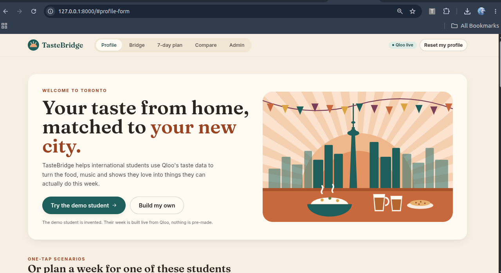
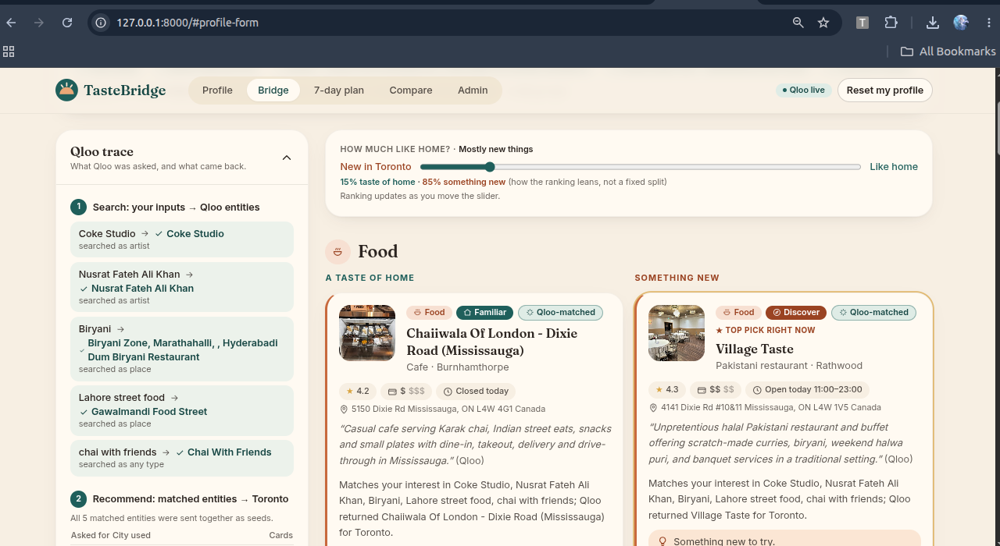
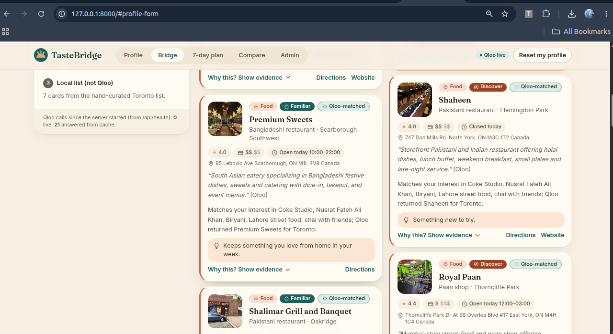
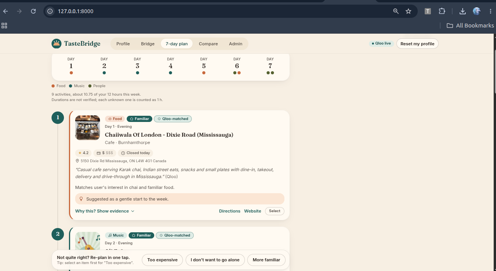
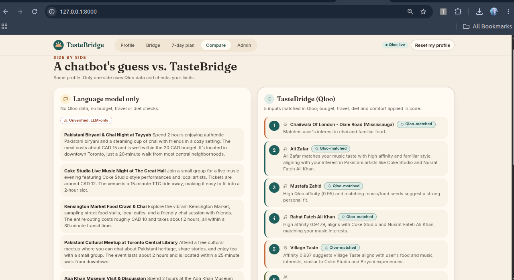

# TasteBridge

A cultural-integration agent that connects what you love from home to what you can realistically do in your new city (demo city: Toronto).

You pick what you want to keep from home and enter a few loved items (dishes, artists, shows, places). The backend resolves them to Qloo entities, asks Qloo for related places in Toronto and related artists, merges that with a hand-curated local list, filters by your budget, travel time, diet and comfort level **in code**, and builds a 7-day plan with Familiar and Discover options. Three feedback buttons re-plan without starting over.

Every card is labelled **Qloo-matched**, **Curated** or **Unverified**, and every unknown fact is shown as "not verified".

**Live demo:** https://tastebridge-sand.vercel.app

Built for the Qloo Agentic Hackathon. MIT licensed.

## What it does

International students arrive in a new city and struggle to find food, music, places and people that feel compatible. Generic advice ("visit the ethnic district") is guesswork, ignores budget and time, and confuses nationality with taste.

TasteBridge asks the student what *they* want to keep from home and what they love: a dish, an artist, a show, a place. It never infers identity from where they come from. It then:

1. Resolves each loved item to a Qloo entity and shows which ones Qloo could not find.
2. Asks Qloo for places in Toronto, and for related artists, seeded by those entities. It keeps only places that Qloo's own genre marks as an outing (restaurants, cafes, venues), so hotels and offices never show up as "food".
3. Shows Qloo's venue facts on each card (photo, rating, price level, today's hours, cuisine, neighbourhood, description) with Directions and Website links.
4. Merges them with a hand-curated local list of real Toronto social opportunities (a U of T language exchange, a newcomer community meal, food bank volunteer shifts, free museum evenings), each checked against its official page.
5. Applies the student's budget, travel, diet and comfort limits in code, then ranks with a Familiar ↔ Discover slider.
6. Builds a 7-day plan with at least one social activity, within their weekly free hours.
7. Re-plans when the student says "too expensive", "I don't want to go alone" or "more familiar", and lists exactly what changed and why.

## Why it is Qloo-powered

Qloo is the taste layer: the step from "loves Coke Studio and biryani" to "these Toronto places and these artists" is Qloo's `search` and `insights` (with `filter.location.query=Toronto`), called at runtime through the official `qloo` CLI. Every Qloo card shows the seed inputs, the Qloo entity, Qloo's affinity value exactly as returned, the location signal used, and the raw (truncated) Qloo record. Ranking weights Qloo evidence highest (45%), and a curated item can never outrank a Qloo match on taste alone.

## What Qloo contributes vs. curated data

| | Qloo | Curated file |
|---|---|---|
| Taste links from your inputs | yes | no |
| Places in Toronto | yes (location filter) | yes |
| Rating, price level (1-4), opening hours, photo | yes (shown as Qloo's) | no |
| Exact price, travel time, diet, verified address/URL | no (shown as "not verified") | yes, where the official page states them |
| Recurring social activities | no | yes |

Each card carries a label: **Qloo-matched**, **Curated** (has url + address + verified date), or **Unverified**.

## How the baseline compared

The Compare page sends the same profile to the same LLM with no Qloo data and shows its raw suggestions, labelled "Unverified, LLM-only", next to the TasteBridge plan.

## Built with

Qloo (`@qloo/qloo-harness` CLI), FastAPI, Pydantic, React, Vite, TypeScript, Tailwind CSS, Docker.

## Screenshots

**Profile:** start with the demo student or build your own profile.



**Bridge:** the Qloo trace shows what was searched and matched; the slider balances "taste of home" against "something new".





**7-day plan:** a week of activities within your hours, with one-tap re-planning.



**Compare:** a language-model-only guess next to TasteBridge's Qloo-grounded plan for the same profile.



## How it works

```
React UI (Onboarding → Bridge → Plan → Compare / Admin)
        │  /api/*
FastAPI ─┬─ resolver.py    loved items → Qloo entities   (qloo api search)
         ├─ candidates.py  Qloo places in Toronto + related artists (qloo api insights) + curated JSON
         ├─ filters.py     budget / travel / diet / comfort (hard rules, unknowns kept + flagged)
         ├─ ranker.py      deterministic score + Familiar/Discover slider
         ├─ planner.py     7-day plan within your weekly hours
         ├─ explain.py     Why this / here / now: template, or optional LLM phrasing of the same evidence
         └─ feedback.py    "too expensive" / "not alone" / "more familiar" → re-plan from cached results
```

The LLM never decides what is recommended. It may only rephrase evidence the backend supplies, and its output is rejected if it adds links or prices.

## Run locally

Requirements: Python 3.11+, Node.js 22.19+ (the Qloo CLI refuses older Node).

```bash
# Qloo CLI (needed only for QLOO_MODE=live)
npm install -g @qloo/qloo-harness@0.1.26

# Backend
cd backend
python3.11 -m venv .venv
.venv/bin/pip install -r requirements.txt

# Frontend (build goes into backend/static and is served by FastAPI)
cd ../frontend
npm ci
npm run build

# Start (mock mode, no keys needed)
cd ../backend
QLOO_MODE=mock .venv/bin/uvicorn app.main:app --port 8000
# open http://localhost:8000
```

For frontend development with hot reload, run the backend on port 8000 and `npm run dev` in `frontend/` (Vite proxies `/api` to the backend).

### Environment variables

See `.env.example`. The backend reads them from the process environment. (It does not load `.env` itself; use `set -a; source .env; set +a` or your host's settings.)

| Variable | Default | Meaning |
|---|---|---|
| `QLOO_MODE` | `mock` | `live` runs the `qloo` CLI; `mock` uses synthetic fixtures and shows a "DEMO DATA, not from Qloo" banner |
| `QLOO_API_KEY` | none | Read by the `qloo` CLI from the environment. Never passed on the command line, logged or sent to the browser |
| `LLM_MODE` | `off` | `on` enables LLM explanations and the LLM-only baseline (needs `LLM_API_KEY`) |
| `LLM_API_KEY`, `LLM_BASE_URL`, `LLM_MODEL` | none | Any OpenAI-compatible endpoint |
| `QLOO_BASE_URL`, `QLOO_TRUSTED_BASE_URL` | Qloo default | Hackathon keys need `https://hackathon.api.qloo.com` in **both**; the CLI refuses an untrusted custom URL |
| `QLOO_BIN` | `qloo` | Path to the CLI |
| `CACHE_DIR` | `./cache` | Disk cache of Qloo responses |
| `PORT` | `8000` | Container port |

## Tests

```bash
cd backend && .venv/bin/python -m pytest -q          # 70 backend tests, mock mode, no network
cd frontend && npm test                              # Vitest: badge, slider, feedback-bar logic
cd frontend && npm run build                         # type-check + production build
cd backend && .venv/bin/python scripts/validate_curated.py   # which curated entries still need real data
cd backend && set -a && source .env && set +a && QLOO_MODE=live .venv/bin/python scripts/smoke_live.py   # live Qloo check
cd backend && .venv/bin/python scripts/discover_qloo.py      # regenerate docs/QLOO_NOTES.md
cd backend && set -a && source .env && set +a && .venv/bin/python scripts/smoke_llm.py   # one LLM call; says why it failed
```

## Demo click path (manual test)

1. Open the app. You'll see the **DEMO DATA** banner in mock mode, and **LLM off, using templates** if no LLM is set.
2. Click **Try the demo student** (origin Pakistan; Coke Studio, Nusrat Fateh Ali Khan, Biryani, Lahore street food, chai with friends; $20 CAD; 12 h/week; 40 min), or **Plan …'s week** on one of the three invented example students.
3. The Bridge page opens. The **Qloo trace** panel shows each input → the Qloo entity (✓) or no match (✗), the city used per request, and how many cards came back.
4. Open **Why this? Show evidence** on any card: seed inputs, Qloo entity, Qloo signal, city signal, raw Qloo data.
5. Move the **Familiar ↔ Discover** slider. The "Top pick right now" marker moves.
6. Open **7-day plan**. Click **Select** on an item, then **Too expensive**: the budget drops 30%, the item is replaced, and "What changed" lists it with the changed cards outlined.
7. Click **I don't want to go alone**: more social items. Click **More familiar**: more familiar items.
8. Open **Compare** (LLM-only vs TasteBridge) and **Admin** (synthetic cohort chart).
9. Click **Reset my profile** to clear the server session.

## Docker and deploy

**Live demo:** https://tastebridge-sand.vercel.app (nothing needs to be built to try the app).

Docker is optional (it is what Render uses). If you have Docker installed, run these from the repository root (the folder that contains `Dockerfile`):

```bash
docker build -t tastebridge .
docker run -p 8000:8000 --env-file backend/.env -e QLOO_MODE=live tastebridge
curl localhost:8000/api/health
```

**Render:** create a new Blueprint from this repo (`render.yaml`), or a Web Service with runtime "Docker". `QLOO_MODE=live` and both Qloo URLs are preset; set `QLOO_API_KEY` (plus the optional `LLM_*` variables) in the dashboard. Render sets `PORT`.

### Vercel

`vercel.json` deploys the repo as one project with two [Vercel Services](https://vercel.com/docs/services) on one domain:

| Service | Root | Public path | What it is |
|---|---|---|---|
| `frontend` | `frontend/` | `/` (everything else) | Vite build, served from the CDN |
| `backend` | `backend/` | `/api/*` | FastAPI (`app.main:app`) as a Python function; it receives the full `/api/...` path |

The browser calls the backend through the public `/api/*` route (same origin), so there are no service bindings. Vercel's Python runtime has no Node, so on Vercel the backend calls the Qloo REST API directly with the same requests the `qloo` CLI makes (`QLOO_TRANSPORT=http`, set automatically when `VERCEL` is present). Vercel installs the backend's runtime dependencies from `backend/pyproject.toml`.

1. Import the repo at vercel.com → **Add New… → Project**. Leave **Root Directory** as `./`; both services and their build settings come from `vercel.json`.
2. Under **Settings → Environment Variables**, add:
   | Name | Value |
   |---|---|
   | `QLOO_MODE` | `live` |
   | `QLOO_API_KEY` | your key |
   | `QLOO_BASE_URL` | `https://hackathon.api.qloo.com` |
   | `QLOO_TRUSTED_BASE_URL` | `https://hackathon.api.qloo.com` |
   | `LLM_MODE`, `LLM_API_KEY`, `LLM_BASE_URL`, `LLM_MODEL` | optional, as in `.env.example` |
3. **Add Redis for sessions.** Serverless instances don't share memory, so a session made by one request can be missing on the next. Go to **Storage → Create Database → Upstash for Redis (free)** and connect it to the project. This sets `KV_REST_API_URL` and `KV_REST_API_TOKEN`, and the app then keeps sessions there for 2 hours. Without it the app still runs, but users may see "Your session expired".
4. Redeploy, then open `https://<your-app>.vercel.app/api/health` (for the live demo: https://tastebridge-sand.vercel.app/api/health). It should show `"qloo_mode": "live"` and `"session_store": "redis"`.

With the CLI: `npm i -g vercel && vercel link && vercel --prod`. Run both services locally with `vercel dev`.

## Qloo calls and quota

- One `qloo api search` per loved item (max 8), then at most two `qloo api insights` calls per session (places filtered to Toronto, and related artists).
- Qloo place results are kept only when Qloo's own `primary_genre` says they are an outing (restaurants, cafes, music venues, museums...). Hotels, offices and shops are dropped, and the Bridge page says how many and why.
- Cards show Qloo's own venue facts: photo, business rating, price level (1-4), today's opening hours, cuisine/genre, neighbourhood and description. Artist photos are not shown.
- At most 2 concurrent CLI calls (semaphore). Timeout 20 s, with one retry only on timeout.
- Successful responses are cached on disk (`cache/`), keyed by a hash of the command arguments, so repeating the same profile costs nothing.
- Feedback, the slider and re-plans **never** call Qloo again; they reuse the session's cached candidates.
- `/api/health` shows `qloo_calls_used` (real CLI invocations since start) and `qloo_cache_hits`.
- Qloo errors are shown to the user as typed errors (auth, rate limit, no result, unavailable). The app never substitutes other data and calls it Qloo.

## Data sources and labels

| Label | Meaning |
|---|---|
| Qloo-matched | Returned by Qloo for your resolved inputs. Affinity is shown exactly as Qloo returned it. Qloo gives no price, travel time or diet info, so those show "not verified". |
| Curated | An entry in `backend/data/curated_toronto.json` with a real `url`, `address` and `verified_on` date, checked against that official page on that date. |
| Unverified | Anything else, including curated entries that are still placeholders. |

`backend/data/curated_toronto.json` holds **13 entries**, all real Toronto places and programs (St. Lawrence Market, U of T's Conversation Bites language exchange, Daily Bread Food Bank volunteer shifts, Aga Khan Museum free Wednesdays and others), each checked against its official page on 2026-10-30. (An international-student welcome mixer was left out: every such event found had already passed.) Fields the official page did not state (often price or travel time) stay `null` and show as "not verified".

Culture-specific picks (chai, chaat, qawwali, Diwali Mela) are offered as **Discover**, never as Familiar, because the app does not infer anyone's culture from where they are from.

To fill them in a spreadsheet: open `backend/data/curated_toronto_fill_me.csv` (one row per placeholder, with a `what_to_find` hint), fill `name`, `address`, `url` (https), `verified_on` (YYYY-MM-DD) and, if known, `cost_cad`, `travel_minutes`, `duration_hours`, `diet_tags` (`;`-separated). Then, from `backend/`:

```bash
.venv/bin/python scripts/curated_from_csv.py import data/curated_toronto_fill_me.csv
.venv/bin/python scripts/validate_curated.py
```

(`curated_from_csv.py export <file>` regenerates the sheet from the current JSON.)

`backend/data/cohort_synthetic.json` (the Admin chart) is generated sample data and is labelled "Synthetic demo data" in the UI.

## Limitations

- One city (Toronto). Changing it means editing `CITY` in `backend/app/config.py` and providing a new curated file.
- No accounts and no database. Sessions live in memory for 2 hours and are lost on restart.
- Qloo returns cultural affinities, not prices, opening hours or event dates. Budget and travel filters can only act on curated entries that have those fields.
- Artist recommendations are not location-filtered. The card says so.
- "Familiar" for a Qloo result means it sits in the top half of Qloo's ranking for your own seeds. It is a heuristic, not a Qloo field.
- Unknown durations count as 1 hour each against your weekly hours (the plan says so).
- The app helps you discover culture and social opportunities. It does not measure or claim to improve wellbeing.

## License

MIT, see [LICENSE](LICENSE).
